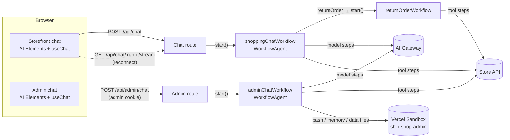

# Ship It Shop: Store Agents

Two AI agents for the Vercel Ship Shop, built on the certification starter:

- **Shopping agent** (storefront chat, robot icon in the header): helps customers find products, inspect an item, and return an order.
- **Store admin agent** (`/admin`, password-protected): helps employees investigate support, returns, inventory, and sales, computes results in **Vercel Sandbox**, and keeps **persistent memory**.

Both use the **AI SDK** with **AI Elements** chat components, route model calls through **Vercel AI Gateway**, and run every model call and tool execution inside **Vercel Workflows** so failures are retried and interrupted work continues.

## Setup

Prerequisites: a Vercel account, a GitHub account, Node.js 22+ (an LTS release supported by Next.js 16), and pnpm.

```bash
pnpm install
vercel link                  # choose the existing project created by the Deploy button
vercel env pull .env.local   # API_BASE_URL, BYPASS_SECRET, VERCEL_OIDC_TOKEN
pnpm dev                     # http://localhost:3000
```

- Storefront: open `/` and click the robot icon (top right) to open the shopping chat.
- Admin: open `/admin` and sign in with the demo password given in the assignment.
- The local `VERCEL_OIDC_TOKEN` expires after 12 hours. Rerun `vercel env pull .env.local` to refresh it. On Vercel, OIDC is automatic.
- Optional local observability: `npx workflow web` opens the Workflows dashboard for local runs. In production, use **Observability → Workflows** in the Vercel project.

Deploying: commit and push to the Vercel-connected repository. No extra environment variables are required on Vercel; AI Gateway and Sandbox use the project's OIDC token automatically.

### Environment variables

Names and descriptions only. Never commit values; `.env.local` is git-ignored. `.env.example` lists the same names.

| Variable | Required | Description |
| --- | --- | --- |
| `API_BASE_URL` | Yes | Base URL of the store API. Prepopulated by the Deploy button; keep it unchanged. |
| `BYPASS_SECRET` | Yes | Store API deployment-protection bypass value. Prepopulated by the Deploy button. Server-only. |
| `VERCEL_OIDC_TOKEN` | Local dev | Authenticates AI Gateway and Vercel Sandbox locally. Written by `vercel env pull`. Not needed on Vercel. |
| `AI_GATEWAY_API_KEY` | Optional | Alternative to OIDC for model calls. If used, set it for Development, Preview, and Production. |
| `AGENT_MODEL` | Optional | AI Gateway model id for both agents. Default `openai/gpt-5.2`. Any model with tool support works. |
| `ADMIN_SANDBOX_NAME` | Optional | Name of the admin agent's persistent sandbox. Default `ship-shop-admin`. |
| `NEXT_PUBLIC_SITE_URL` | Optional | Public site URL for metadata. Default `http://localhost:3000`. Contains no secret. |

No secret uses a `NEXT_PUBLIC_` prefix, and none is sent to the browser, put in the sandbox, or included in tool results.

## Architecture



Each chat message starts one workflow run. The agent (`WorkflowAgent` from `@ai-sdk/workflow`) runs every model call and every tool execution as a workflow step and writes its output to the run's durable stream. The route streams that run back to the browser and returns its id in `x-workflow-run-id`.

### Code map

| Path | What it does |
| --- | --- |
| `lib/agent.ts` | Model choice and both agents' instructions. |
| `lib/tools.ts` | All tools. Each tool's work is a `"use step"` function. Exports `shoppingTools` and `adminTools` separately. |
| `lib/workflows/chat-flow.ts` | `shoppingChatWorkflow`: the durable shopping agent. |
| `lib/workflows/return-flow.ts` | `returnOrderWorkflow`: notify → pre-authorize refund → file return → wait for the decision. |
| `lib/workflows/admin-chat-flow.ts` | `adminChatWorkflow`: loads memory, then runs the durable admin agent. |
| `lib/sandbox.ts` | The admin's persistent sandbox: bash, data files, memory file. |
| `lib/chat-route.ts` | Request validation, starting runs, resuming streams, admin auth check. |
| `app/api/chat/route.ts`, `app/api/chat/[id]/stream/route.ts` | Shopping chat start and reconnect. |
| `app/api/admin/chat/route.ts`, `app/api/admin/chat/[id]/stream/route.ts` | Admin chat start and reconnect (admin only). |
| `components/chat/durable-chat.tsx` | Shared AI Elements chat: transport, persistence, reconnect, progress, errors. |
| `components/chat/shopping-tool-parts.tsx` | Generative UI: product results, product details, return confirmation, tool states. |
| `components/chat/admin-tool-parts.tsx` | Back-office lookup summaries, sandbox terminal, memory confirmations. |

## Shopping agent

**Tools** (`shoppingTools`):

| Tool | Behavior |
| --- | --- |
| `searchProducts` | Text and category search; no arguments browses the full catalog. Categories are validated against `getCategories()`; an unknown category returns the valid list. |
| `getAllCategories` | Current categories with product counts, from store data. |
| `getProductDetails` | One product's description, price, all images, tags, and live stock (`/products/:id/stock`). |
| `returnOrder` | Looks up the order, rejects missing or ineligible orders (paid, pending, cancelled), then starts `returnOrderWorkflow` and confirms that the return was filed. The store API accepts duplicate returns, so the start is idempotent per order (a Workflow start hook with the token `return:<orderId>`, kept for 24 hours): a repeated request is refused instead of filing twice. |

**Generative UI.** Search results render as browsable product cards (image, name, formatted price, link to the existing product page). Details render as a product card with images, description, price, live stock, category, and tags. Returns render as a confirmation card. Every tool shows a progress state and explains failures, missing products, and empty results.

**Durability.**
- Model calls and tool executions are workflow steps: transient store or model failures are retried, and completed steps are never repeated.
- `returnOrder` returns as soon as the return workflow starts, so the chat isn't blocked. In `returnOrderWorkflow`, notifying the customer, pre-authorizing the refund, and filing the return are separate steps. If filing fails and is retried, the customer isn't notified twice and the refund isn't pre-authorized twice (the store creates a new authorization on every call). 4xx responses fail permanently (`FatalError`); network errors, 5xx, and 429 retry.
- The return workflow passes a Workflow webhook URL as the store's `callback` and waits for the decision (approved / rejected / needs info), falling back to polling `GET /returns/:id` after three minutes. Webhook URLs are built from the deployment-specific hostname, which Vercel deployment protection puts behind a login, so in production the callback is sent to the public production domain instead. On preview deployments and locally, the polling fallback is used.

**Chat recovery.** The browser keeps the conversation and the id of any in-progress run in `localStorage`.
- If the connection drops mid-reply, `WorkflowChatTransport` reconnects to `/api/chat/:runId/stream?startIndex=N`.
- After a page refresh, the finished turns are restored and the chat re-attaches to the same run.
- The resume route replays the run's stream and skips exactly the UI chunks the client already has, so output is never duplicated, and nothing is re-sent, so the same task never starts twice.
- The resume routes only serve runs of their own workflow, so a shopper can't read admin runs.

## Store admin agent

**Tools** (`adminTools`, never given to the shopping agent):

| Tool | Behavior |
| --- | --- |
| `getSupportTickets` | Date, status, priority, category, assignee, and limit filters. |
| `getReturnsHistory` | Date, status, decision, and limit filters. Includes order totals and refund amounts; return items are enriched with product names. |
| `getInventoryStock` | Product ids, low-stock, and in-stock filters. Paginated, with an `allPages` option for complete joins. |
| `getSalesAnalytics` | Date range, optional product, totals in the result metadata. |
| `searchProducts`, `getAllCategories` | Catalog context for identifying products before combining data. |
| `bash` | Runs a command in the admin's Vercel Sandbox (jq, python3, node available). |
| `saveMemory` | Appends a dated note to the memory file. |

**Read-only.** All store access is GET-only; the agent's instructions forbid claiming to change inventory, resolve tickets, or issue refunds.

**Sandbox computation.** Each back-office tool saves its full result as a JSON file in the sandbox (`/vercel/sandbox/data/…`) and returns a compact summary plus the path. The agent then uses `bash` for arithmetic, aggregation, and joins (for example, return rate = units returned ÷ units sold, or low-stock items joined with sales) instead of guessing. The chat shows each command, a running state, its output, its exit status, and failures. Store data is written into the sandbox by the application; no credentials ever enter it.

**Persistent memory.** One named, persistent sandbox (`ship-shop-admin`) holds both the data files and the memory file `/vercel/sandbox/memory/MEMORY.md`.
- At the start of every admin turn, application code (`loadMemoryStep`) reads the file and adds it to the agent's instructions.
- `saveMemory` appends to the file.
- A new conversation therefore starts with the saved preferences, corrections, and business context.
- With no saved memory, the agent is told it's starting fresh.
- If the sandbox is unavailable, the turn continues without memory and the agent says so if asked.

**Access control.** `/admin` pages are guarded by `proxy.ts`. The admin API routes verify the same session cookie themselves (the proxy only matches `/admin/*`). The login cookie is set with `path: "/"` so the browser also sends it to `/api/admin/*`; with the starter's original `path: "/admin"`, the admin chat API would never receive it.

## Decisions and trade-offs

- **`WorkflowAgent` (`@ai-sdk/workflow`)** instead of the deprecated `DurableAgent`: `@workflow/ai` only supports AI SDK 6, and this project uses AI SDK 7.
- **Model:** `openai/gpt-5.2` through AI Gateway: reliable tool calling, low latency, and correct money formatting in testing. Change it with `AGENT_MODEL`.
- **Model resilience:** AI Gateway fallback models (`openai/gpt-4.1-mini`, then `openai/gpt-5-mini`) take over if the primary model fails or is rate-limited, and model calls retry with backoff for about a minute (`maxRetries: 5`). This matters on AI Gateway's free tier, which limits requests per minute per model.
- **Errors:** tools return `{ ok: false, error }` for expected problems (validation, not found, ineligible) so the agent can explain them, and throw for transient failures so the workflow retries. Error text is built only from status, code, and path; the store client puts `BYPASS_SECRET` in request URLs, so raw error details are never passed to the model.
- **Conversation storage is per browser** (`localStorage`). That covers refresh and reconnect for this demo; a production version would store conversations server-side per user.
- **Admin auth is the starter's demo cookie** (the cookie value is the password). It's kept as provided and isn't suitable for real use.

## Verifying it

- **Shopping:** "What categories do you have?", "Show me hoodies", "Tell me more about that one", "Return order 11111, it's too small". Order `44444` (paid) and `55555` (cancelled) are not returnable; `99999` doesn't exist. Refresh the page while a reply is streaming to see it reconnect.
- **Admin:** "Which products have the highest return rates?", "Which low-stock items are top sellers?". Then "Remember that our fiscal week starts on Monday", start a **New chat**, and ask "What is revenue for the current fiscal week?".

## Scripts

| Command | Description |
| --- | --- |
| `pnpm dev` | Start the dev server |
| `pnpm build` | Production build (compiles workflows and steps) |
| `pnpm start` | Serve the production build |
| `pnpm typecheck` | TypeScript check (also enforced by `pnpm build`) |
